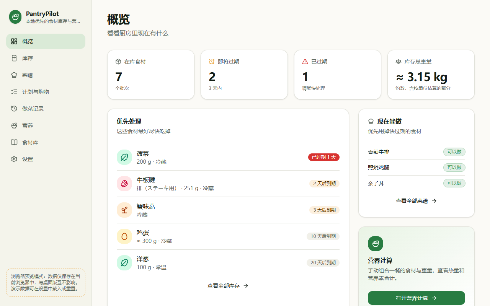
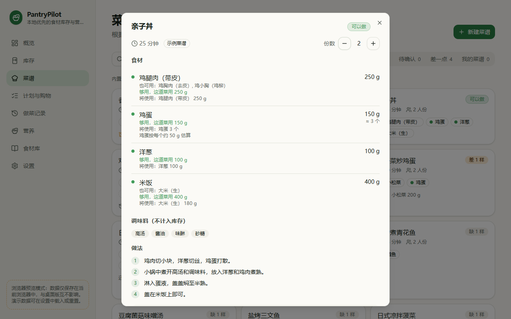
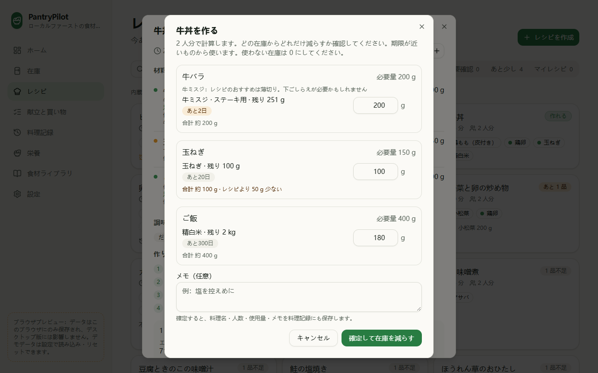
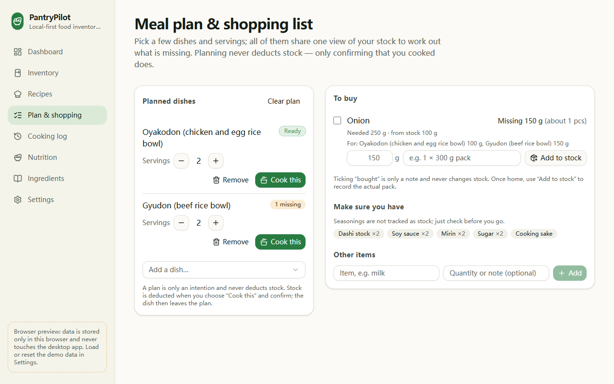
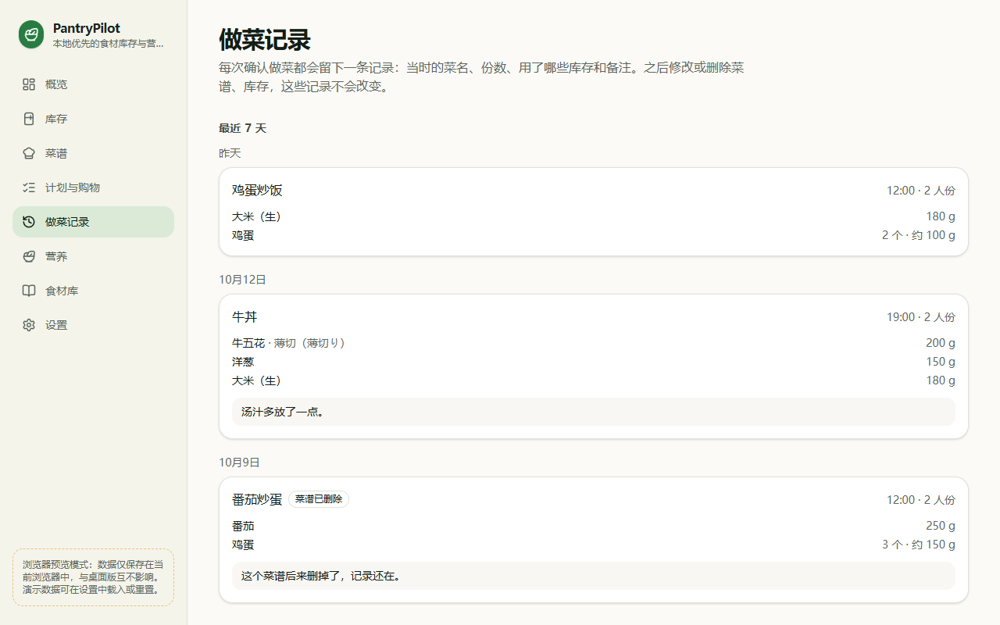

# PantryPilot

> Working name — see [CONTRIBUTING.md](CONTRIBUTING.md#renaming-the-project) for how to rename.

**A local-first desktop app that tracks the food you actually have, shows what you can cook
with it, and works out one shopping list for several dishes.** Built with Tauri 2, React,
TypeScript and SQLite; it runs fully offline and sends your data nowhere.



## What it does

- **Stock as you buy it.** Record packs the way (Japanese) supermarkets sell them — "beef /
  misuji / steak / 251 g" — with expiry dates, and see what to use first.
- **What can I cook?** Recipes are matched against your lots. One allocation is shared by all
  lines of a recipe, so a lot is never counted twice, and every suggestion shows which lots it
  would use and why.
- **Plan several dishes.** All planned dishes share one stock balance: with 100 g of onion and
  two dishes needing 80 g each, the shopping list says 60 g, not "nothing".
- **Cook and keep a log.** You confirm each deduction; the deductions and a cooking record are
  saved in one transaction, and retrying never deducts twice. Recently cooked dishes move down
  the list.
- **Three languages.** Simplified Chinese (default), English and Japanese, for the UI and the
  food names.

It is **not** a calorie-counting or dieting app and gives no medical advice.

## Status

A personal project in active development. The cooking log, meal plan and shopping list (V0.3)
are done; real nutrition data (V0.4) is next. Nutrition values are **demo data** for now.
A Windows NSIS installer can be built with `pnpm tauri build` (unsigned pre-release; see
[docs/releases/0.1.0.md](docs/releases/0.1.0.md)). macOS/Linux have not been tested. Progress
is tracked in [ROADMAP.md](ROADMAP.md) (checklist, Chinese).

## Quick start

Needs Node.js 22+ (CI uses 24), pnpm 12, and for the desktop app Rust with the
[Tauri 2 prerequisites](https://tauri.app/start/prerequisites/).

```bash
pnpm install
pnpm tauri dev   # desktop app
pnpm dev         # or a browser preview at http://localhost:1420 —
                 # Settings → "Load sample data" fills it with made-up demo data
```

## Screenshots

From the browser preview with the bundled, made-up demo data; the desktop app shows the same UI.

| Recipe detail: which lots each line uses                       | Cook dialog (Japanese): confirm or change each deduction   |
| -------------------------------------------------------------- | ---------------------------------------------------------- |
|              |  |
| **Meal plan (English): one merged gap for two dishes**         | **Cooking log: snapshots that survive deleted recipes**    |
|  |           |

## Privacy

PantryPilot stores user data locally and does not send inventory, recipe or nutrition data to
external servers.

There is no account, no cloud sync, no analytics and no telemetry. The only network access is
the Vite dev server on `localhost` during development.

## Features in detail

- **Ingredient taxonomy** — ingredient definitions (nutrition identity, e.g. "beef misuji"),
  product forms (steak, yakiniku slices, ground…) and inventory lots are separate concepts.
  Built-in definitions have stable snake_case IDs; user data uses UUIDs.
- **Trilingual** — UI and food names in Simplified Chinese (default), English and Japanese.
  Search works across all three, including kana/width normalisation.
- **Inventory** — add / edit / delete lots, consume, adjust, discard, mark opened, change
  storage, freeze. Every change is recorded as a transaction. Remaining amounts never go negative.
- **Expiration tracking** — expired / today / tomorrow / within 3 days / normal; sorting and a
  dashboard of what to use first.
- **Recipes** (V0.2) — 16 built-in example home-cooking recipes plus your own. Recipes are
  matched against current stock ("ready" / "almost": 1–2 items short), preferring recipes that
  use food expiring soon. Lines can be optional, accept alternatives (e.g. komatsuna for
  spinach) or any cut of the same species. "Cook this" deducts the used amounts from your lots,
  earliest expiration first, after you confirm or adjust each amount. All deductions of one cook
  are saved in a single database transaction, and retrying a cook never deducts twice.
- **Cooking log** (V0.3) — each cook is saved, in the same transaction as its deductions, as a
  record with the recipe name, servings, amounts per lot (weighed or estimated) and an optional
  note. Records are snapshots, so they stay readable after the recipe or lot is edited or
  deleted. Recipes cooked in the last few days (configurable) are listed after similar options,
  with a note saying when you made them. Deductions from before V0.3 are shown as-is, one by
  one, and are not turned into records.
- **Meal plan and shopping list** (V0.3) — pick several recipes and servings; all dishes share
  one stock balance, so two dishes needing 80 g of onion with 100 g in stock show a 60 g gap.
  Gaps are merged per ingredient with the recipes they come from; amounts that cannot be
  measured are listed separately, and seasonings stay a "check at home" list. Planning never
  deducts stock, and ticking "bought" is only a mark: "enter stock" opens the normal form so you
  record the pack you actually bought.
- **Nutrition** — values per 100 g edible portion; _unknown is never treated as zero_. Totals
  with missing values are flagged as lower bounds. A nutrition sandbox lets you combine foods and
  weights; recipes show an estimated per-serving value. Experimental 1–10 heuristic scores are
  derived on the fly and never stored.
- **Backup** — JSON export / import (ingredients, lots, transactions, custom recipes, cooking
  records, meal plan, shopping list, settings)
  with a `schemaVersion` and migration chain. Import replaces all data in one transaction; if it
  fails, the previous data is kept.

### About the built-in data

The bundled nutrition values are **demo data** — plausible approximations for development, not
an authoritative dataset. They are labelled as such in the UI. Every value carries a source ID
so a real regional dataset (e.g. the Standard Tables of Food Composition in Japan) can be added
later without changing the data model.

The built-in recipes are **examples** with typical home-cooking amounts, not tested cookbook
recipes. Seasonings are listed as text and are not matched against inventory.

## Getting started

Prerequisites:

- Node.js 22+ and [pnpm](https://pnpm.io) (`corepack enable`)
- Rust (stable) and the [Tauri 2 prerequisites](https://tauri.app/start/prerequisites/)
  (on Windows: Visual Studio Build Tools with the C++ workload, WebView2)

```bash
pnpm install
pnpm tauri dev      # desktop app (SQLite in the app config directory)
pnpm dev            # browser preview only (sql.js, stored in localStorage;
                    # Settings → "Load sample data" fills it with demo inventory and history)
```

Build a Windows NSIS installer (unsigned; SmartScreen may warn):

```bash
pnpm tauri build
# → src-tauri/target/release/bundle/nsis/PantryPilot_0.1.0_x64-setup.exe
```

Details, SHA-256 and a smoke-test checklist:
[docs/releases/0.1.0.md](docs/releases/0.1.0.md). GitHub Actions → **Build Windows installer**
(manual) can produce the same artifact.

### Where is my data?

The desktop app stores everything in a single SQLite file named `pantrypilot.db` in the
OS app-config directory for the identifier `dev.pantrypilot.desktop`:

| OS      | Location                                                 |
| ------- | -------------------------------------------------------- |
| Windows | `%APPDATA%\dev.pantrypilot.desktop\pantrypilot.db`       |
| macOS   | `~/Library/Application Support/dev.pantrypilot.desktop/` |
| Linux   | `~/.config/dev.pantrypilot.desktop/`                     |

The exact path is shown in **Settings → Data**. Use **Export** there for backups.

## Development

| Command          | What it does                               |
| ---------------- | ------------------------------------------ |
| `pnpm typecheck` | TypeScript (strict) project check          |
| `pnpm lint`      | ESLint                                     |
| `pnpm format`    | Prettier (write)                           |
| `pnpm test`      | Vitest (domain, services, SQLite, locales) |
| `pnpm check`     | typecheck + lint + format check + tests    |

See [ARCHITECTURE.md](ARCHITECTURE.md) for how the code is organised and
[CONTRIBUTING.md](CONTRIBUTING.md) for conventions.

## Known limitations

- Nutrition values are demo data, not an authoritative dataset.
- Built-in recipes are examples; seasonings are not tracked in inventory.
- Cooking records have no nutrition snapshot and cannot be undone.
- The shopping list leaves out optional ingredients, counts edible grams (bone-in cuts need
  more at the shop) and cannot add manual items to stock.
- Import replaces all data; there is no merge.
- Tested on Windows only. An unsigned NSIS installer can be built locally or via a manual
  workflow; there is no signed public release and no auto-update.

## License

A license has not been selected yet. Until one is added, all rights are reserved by the authors.
